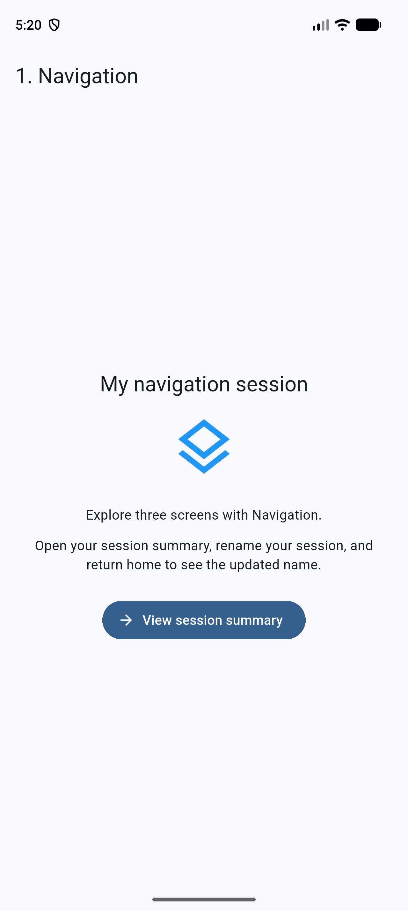
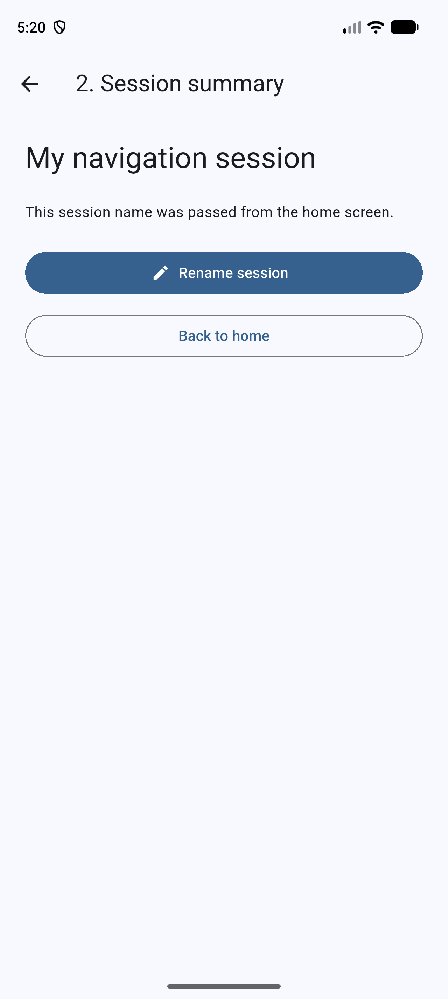
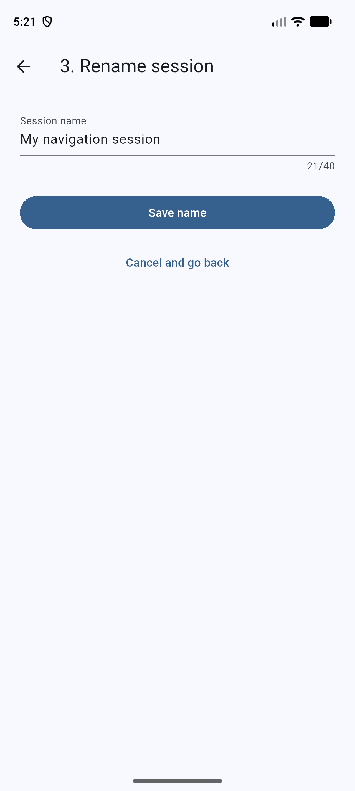
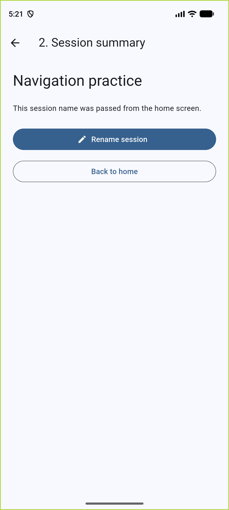
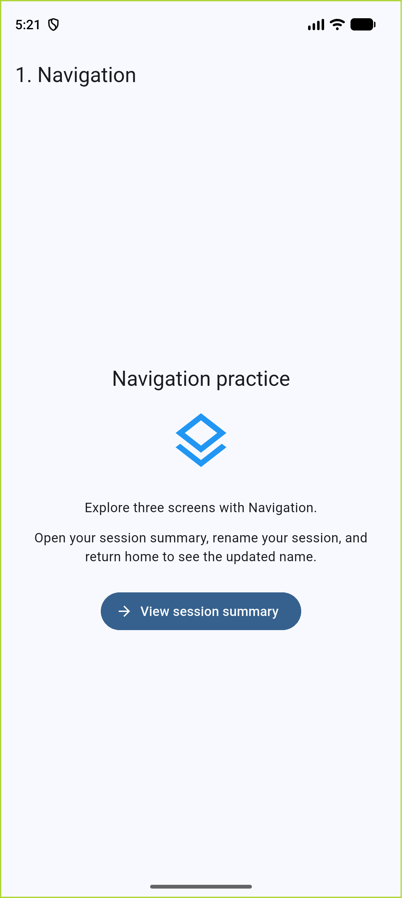

# Navigation App Reflection

I implemented Navigation as a three-screen Flutter app using a stack-based navigation structure. The home screen forms the bottom of the stack, followed by the session summary and the rename screen. Each forward transition uses `Navigator.push` with a `MaterialPageRoute`, while backward transitions use `Navigator.pop`. This structure keeps previous screens available instead of creating another home screen every time the user returns. It also preserves the session name while users move through the app.

Users begin on the home screen, where they see their current session name and a clearly labeled “View session summary” button. Selecting that button opens the summary and passes the session name through its constructor. From the summary, users select “Rename session” to open the third screen. The rename screen displays the existing name in a text field. Users can enter a new name and select “Save name,” which closes the route and returns the updated text to the summary. Empty or whitespace-only names trigger a validation message. Selecting “Cancel and go back” or the back arrow discards an unfinished edit. The summary provides both an app-bar back arrow and a “Back to home” button.

One navigation issue involved returning updated data when users left the summary through the back arrow. A normal back action returned a null route result, so a name saved on the rename screen could disappear when the home screen became visible again. I resolved this by using `PopScope<String>` on the summary to intercept backward navigation and return its current session name. The home screen awaits that result and updates its state. I also check `mounted` before updating state after an asynchronous navigation operation.

Testing helped verify both the problem and the solution. Temporarily disabling the back-navigation fix caused the saved-name regression test to fail; restoring it made the test pass. Widget tests also checked cancellation, system back navigation, and blank-name validation. An integration test passed on the Pixel 10 Pro Android emulator. Overall, this project showed me that navigation includes managing returned data consistently across every available exit path, as well as opening and closing screens.

## Screenshot sequence

1. Home: the starting screen and forward-navigation button.
2. Summary: the session name received from home.
3. Rename: the third screen with save and cancel controls.
4. Saved summary: the updated name returned from the rename route.
5. Returned home: the updated name preserved after navigating backward.

